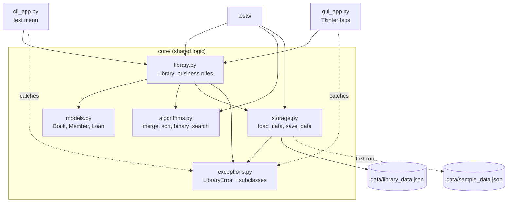
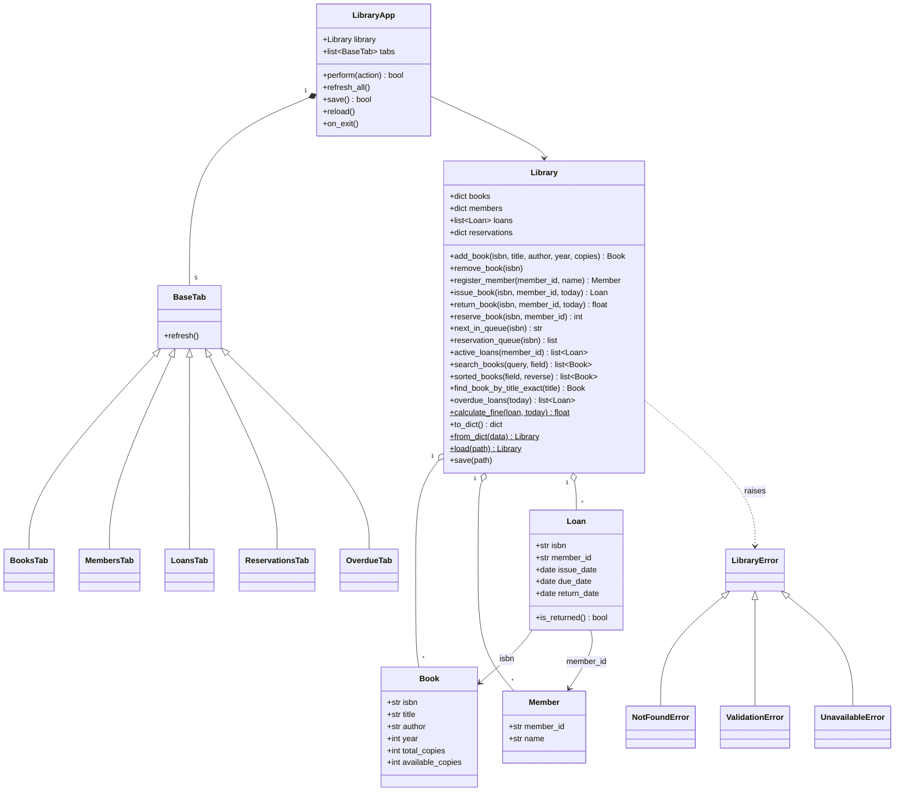

# Design — Library Loans Manager

This document describes the data structures, algorithms and module/class
structure behind both front ends. Requirement IDs refer to
[requirements.md](requirements.md).

## 1. Architecture

All data and rules live in the `core/` package. The two front ends only
collect input, call one `Library` method and display the result (NFR3).
`core/` never prints, reads input or imports tkinter. It reports problems by
raising the exceptions in `core/exceptions.py`, which each front end catches
and shows as a message (NFR1, NFR2).

### Module diagram



### Class diagram



## 2. Data structures

| Structure | Where used | Why | Complexity |
|-----------|------------|-----|------------|
| `dict[str, Book]` (ISBN → Book) | `Library.books` | Every issue, return, reservation and ISBN search looks a book up by ISBN | Lookup, insert, delete O(1) average (NFR5) |
| `dict[str, Member]` (ID → Member) | `Library.members` | Members are always found by ID | Lookup, insert O(1) average (NFR5) |
| `list[Loan]` | `Library.loans` | Keeps the full loan history in issue order; returned loans stay as a record | Append O(1); scanning for active loans O(n) |
| `dict[str, deque[str]]` (ISBN → queue of member IDs) | `Library.reservations` | A FIFO queue per book: first to reserve is first served (FR6). `deque` removes from the front in O(1), where `list.pop(0)` is O(n) | Find queue O(1); append and pop-left O(1); duplicate check O(k) for a queue of k |
| `@dataclass` records | `Book`, `Member`, `Loan` in `models.py` | Clear named fields, automatic `__init__`/`__eq__`, simple `to_dict`/`from_dict` for JSON | O(1) field access |
| JSON object with lists (and a dict of lists for queues) | `storage.py`, data file | Human-readable, standard library only (NFR4); a deque is saved as a list in queue order | Load/save O(n) |

## 3. Algorithms

### 3.1 Merge sort (`core/algorithms.py`, FR8)

Used by `sorted_books`, `overdue_loans` and `find_book_by_title_exact`.
It is written by hand rather than with `sorted()` so the design and
complexity can be discussed.

```
function MERGE_SORT(items, key, reverse):
    if length(items) <= 1:
        return copy of items
    middle <- length(items) div 2
    left  <- MERGE_SORT(items[0 .. middle-1], key, reverse)
    right <- MERGE_SORT(items[middle .. end], key, reverse)
    return MERGE(left, right, key, reverse)

function MERGE(left, right, key, reverse):
    result <- empty list; i <- 0; j <- 0
    while i < length(left) and j < length(right):
        if reverse: right_first <- key(left[i]) < key(right[j])
        else:       right_first <- key(right[j]) < key(left[i])
        if right_first: append right[j] to result; j <- j + 1
        else:           append left[i]  to result; i <- i + 1   // ties take LEFT
    append remaining left[i..] and right[j..] to result
    return result
```

- **Time:** O(n log n) in every case: the list is halved log n times and each level merges n items (NFR5).
- **Space:** O(n) for the merged lists.
- **Stable:** on equal keys the item from the left half is taken first, so equal
  items keep their original order. For descending order the comparison is
  flipped rather than the result reversed, so `reverse=True` is stable too.
- The input list is never modified; a new list is returned.

### 3.2 Binary search (`core/algorithms.py`)

Used by `find_book_by_title_exact` after merge-sorting the books by title.

```
function BINARY_SEARCH(sorted_items, target, key):
    low <- 0; high <- length(sorted_items) - 1
    while low <= high:
        mid <- (low + high) div 2
        if key(sorted_items[mid]) = target: return sorted_items[mid]
        if key(sorted_items[mid]) < target: low <- mid + 1
        else:                               high <- mid - 1
    return NOT FOUND
```

- **Time:** O(log n), because each step halves the range. **Space:** O(1) (iterative).
- It needs a list sorted ascending by the same key, so the whole lookup is
  O(n log n) for the sort plus O(log n) for the search.

### 3.3 Search (`Library.search_books`, FR7)

```
if field = "isbn":   return [books[clean(query)]] if present else []    // O(1)
else:                return [b for b in books if lower(query) in lower(b.field)]   // O(n)
```

A partial, case-insensitive match cannot use a hash or binary search, so title
and author use a linear scan. ISBN is an exact key, so it uses the dict.

### 3.4 ISBN-13 checksum (`validate_isbn`, FR1)

```
digits <- isbn without spaces and hyphens
if length(digits) != 13 or digits has a non-digit: invalid
total <- sum(digit[i] * (1 if i is even else 3) for i in 0..12)
valid if total mod 10 = 0
```

### 3.5 Issue with reservation rule (`Library.issue_book`, FR4, FR6)

```
book <- books[isbn]; member <- members[member_id]        // NotFoundError if missing
if member already holds book:            UnavailableError
if member has MAX_LOANS_PER_MEMBER loans: UnavailableError
if book.available_copies = 0:             UnavailableError
queue <- reservations[isbn]
if queue not empty:
    if queue.front != member: UnavailableError        // only the front may borrow
    queue.pop_front()                                   // O(1) with deque
create Loan(due = today + LOAN_PERIOD_DAYS); available_copies -= 1
```

### 3.6 Fine (`Library.calculate_fine`, FR5, FR9)

```
end  <- loan.return_date if returned else today
fine <- round(max(0, days(end - loan.due_date)) * FINE_PER_DAY, 2)
```

### 3.7 Overdue report (`Library.overdue_loans`, FR9)

Filter active loans with `due_date < today` (O(n)), then merge-sort them by
due date (O(k log k)) so the oldest is listed first.

### 3.8 Safe save (`storage.save_data`, NFR6)

```
write JSON to "<file>.tmp"; flush; fsync
os.replace("<file>.tmp", "<file>")      // atomic: the old file or the new one, never half
```

## 4. Error handling

| Exception | Raised when | Examples |
|-----------|-------------|----------|
| `ValidationError` | Input breaks a rule | Bad ISBN checksum, duplicate ISBN or member ID, year outside 1000..current year, blank name, unknown search field |
| `NotFoundError` | Something does not exist | Unknown ISBN or member, returning a book that is not on loan |
| `UnavailableError` | Valid request that cannot happen now | No copies left, 3-loan limit, removing a book on loan, not first in the reservation queue |
| `LibraryError` (base) | Storage problems | Corrupt JSON, missing section, unwritable file |

Both front ends catch `LibraryError`. The CLI prints the message and shows the
menu again; the GUI shows a message box. In both, the data is left unchanged.
